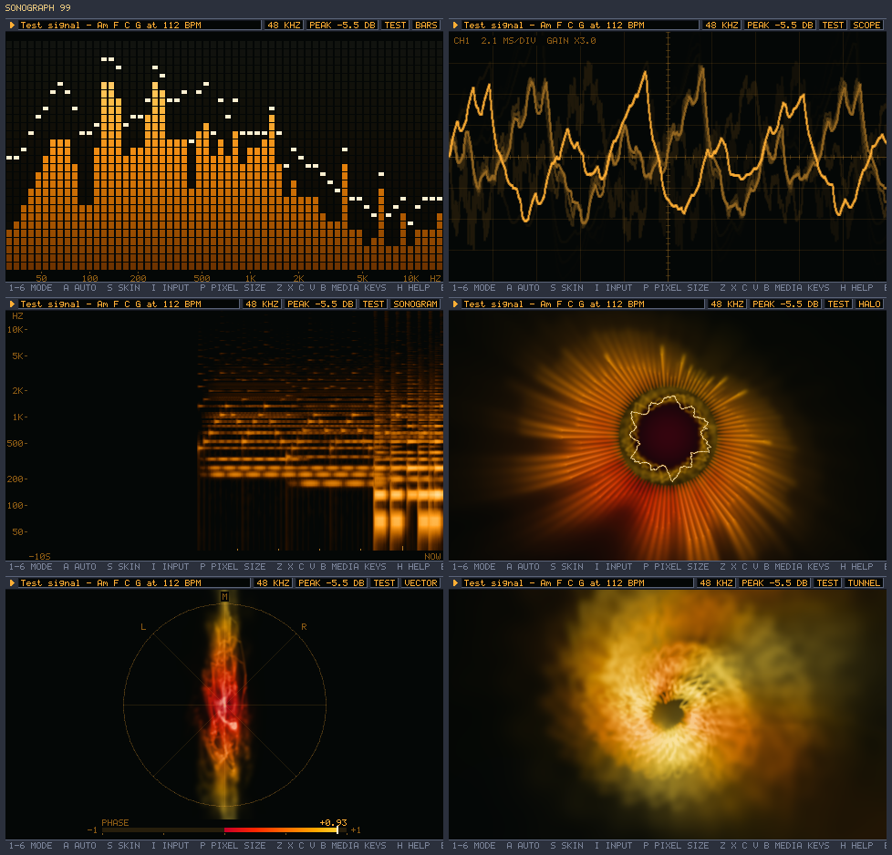

# Sonograph 99

A late-90s style music visualizer, written in Rust. It shows whatever your computer is
playing, so it works with Spotify, YouTube, Tidal, Apple Music, or any other app.



## How it hears Spotify

Streaming apps encrypt their audio, so no program can read the stream itself. Sonograph 99
listens to the system output instead. On Windows this is WASAPI loopback capture: a copy of
the mix that goes to your speakers or headphones. Nothing is recorded or saved.

It also reads the Windows media controls. That gives the artist and title of the current
track, and lets the player keys control Spotify or any other app that registers with them.
No account or API key is needed.

## Run it

```
cargo run --release
```

The first build takes a minute or two. Then play something in Spotify or any other app.

Options:

| Option | Effect |
| --- | --- |
| `--mic` | Listen to the default microphone or line-in |
| `--test` | Show the built-in test signal (a synth loop, Am F C G at 112 BPM) |
| `--mode <1-11>` | Start in a mode |
| `--skin <name>` | One of the [14 color skins](#color-skins) |
| `--pixel <1-4>` | Pixel size. Larger is chunkier and faster. Default 2 |
| `--auto` | Change mode on a beat, about every 15 seconds |
| `--fullscreen` | Start in borderless fullscreen on Windows |
| `--preset <name or file>` | Recipe for Tunnel and Orbs: a built-in name (see [Visual recipes](#visual-recipes)) or a recipe file |
| `--save-preset <file>` | Save the selected recipe to a new file and exit |
| `--probe` | Listen for 3 seconds without a window, then report the device, level, and media app |
| `--snapshot <file>` | Render every mode from the test signal to a BMP file |
| `--render <wav> <folder>` | Draw a WAV file as numbered BMP frames in an empty folder, then exit |
| `--fps <1-240>` | Frame rate for `--render`. Default 60 |
| `--size <WxH>` | Picture size for `--render`. Default `1280x720` |

## Color skins

Press **S** to cycle the skins. The original Classic, Amber, Ice, and Orchid are joined by
**Aurora, Sunset, Lagoon, Candy, Ember, Citrine, Dracula, Mocha, Ocean, and Neon**.
The new skins have colored navy, burgundy, petrol, plum, olive, or charcoal backgrounds
and deeper gradients from shadow through saturated color to luminous highlights.
Backgrounds apply to the visuals, silence, and LCD readouts.

Start with `--skin lagoon` on desktop or `?skin=lagoon` in the browser.
See [palette sources and colors](docs/skin-sources.md) for the uiGradients, Dracula,
and Catppuccin references and how they were adapted.

## Default keys

| Key | Action |
| --- | --- |
| `M` | Open the visual and function catalogue |
| `1`-`9`, `0` (also numpad) | Run an assigned hotkey; defaults to the first ten visuals, with `0` for the tenth |
| `G` | Gravity Waves, the eleventh visual |
| Left, Right | Pick the previous or next visual |
| Down, Up | Slower or faster pattern rate (0.25x to 2x) |
| `T` | Toggle pulse: beat and attack accents on/off |
| `A` | Auto: change mode on a beat, about every 15 seconds |
| `R` | Next recipe in Tunnel or Orbs |
| `S` | Next skin |
| `I` | Next input: loopback, microphone, test signal |
| `P` | Pixel size 1 to 4 |
| `Z` `X` `C` `V` `B` | Previous, play, pause, stop, next (sent to the media app) |
| `H` | Show or hide the key help |
| `F11` | Toggle fullscreen on Windows |
| `F12` | Miniaturize to a floating, music-reactive Halo on Windows |
| `Esc` | Close the catalogue, leave fullscreen, or quit when already windowed |

If the app does not accept Stop, `V` pauses it instead.

Click **Fullscreen** in the top bar, press **F11**, or run **Toggle fullscreen**
from the Functions catalogue to fill the current monitor with just the visual. The
header, footer controls, and help strip are hidden. Press **F11** or **Esc** to restore the previous window size and position
(including a maximized window). When the catalogue is open, Esc closes it first.
Press **M** to open the catalogue while fullscreen. The fullscreen shortcut can be
reassigned like other functions. Older settings with an unused F11 automatically
gain the fullscreen shortcut; custom F11 and fullscreen assignments are preserved.

Click **Miniaturize** in the top bar, press **F12**, or run **Miniaturize** from the
Functions catalogue to hide the player and show a small Halo over other applications.
The Halo keeps responding to the current audio input and uses the selected skin,
pattern rate, and pulse setting. Its glow has a transparent background and passes
clicks through to the applications underneath. Only the circular center takes input.
**Drag the center** to move it; **double-click or right-click the center** to restore
the player, including its previous visual and normal, maximized, or fullscreen placement.
Auto switching pauses while miniaturized, keeping the avatar on Halo. Its position is
remembered during the session. F12 can be reassigned in the catalogue; older settings
gain it only when neither F12 nor Miniaturize has a custom assignment.

## Catalogue and hotkeys

Click **M Catalogue** in the top bar, or press **M**. Choose the **Visuals** or
**Functions** tab, then click an entry (or use Up/Down). Press a letter or **0-9**, or click
a numbered button, to assign that key to the selected entry. For example, select
**Slower patterns** and press **Q**, then select **Faster patterns** and press **E**.
The assignment replaces
that key's previous action; the labels beside each entry show its current shortcuts.
Both the number row and numpad use the same assignments.

For keys already used by the menu (such as **D**, arrows, Tab, Space or the default
fullscreen key **F11**), select an entry, press **Enter** (or click **Enter:bind**),
then press the new key. Numbers 0-9, letters, arrows, Tab, Space, Backspace and F1-F12
are supported; **M** stays reserved for the menu. Reassignment removes that function's
old shortcut and replaces any action already on the new key. **Esc** cancels capture.

**Space** runs the selected entry and closes the menu. **Delete** clears its assigned
keys; **D: defaults** restores all default visual and function shortcuts. Use Left/Right
or Tab to switch tabs, and the mouse wheel or Page Up/Down to browse longer lists.
**Esc** or **M** closes the menu when no reassignment is pending.

Click **Pulse on/off** beside the Rate buttons, press **T**, or run **Toggle pulse**
from the Functions catalogue. Pulse starts on. Turning it off suppresses beat and
attack accents in both visuals during transitions; spectrum, waveform, band-driven
motion, and auto mode's beat timing keep working. The setting carries across visual
and recipe changes during the session. Assign its hotkey through the catalogue like
other functions; assignments save across restarts. Older settings gain **T** only
if neither T nor Pulse has a custom assignment.

Functions include visual cycling, pulse, auto mode, recipes, skins, input, pixel size, help,
and media playback. Function letters and visual numbers use the same saved bindings;
an old shortcut stops running its function after reassignment. Existing number-only
settings files remain supported and retain default function keys until edited. A file
saved before Mandala was added has no line for key 0, so 0 runs Mandala. Older settings
gain **G** for Gravity Waves only if neither G nor Gravity Waves has a custom assignment.

Assignments save automatically to `%APPDATA%\Sonograph99\hotkeys.conf` on Windows
(or `$XDG_CONFIG_HOME/Sonograph99/hotkeys.conf`, falling back to
`~/.config/Sonograph99/hotkeys.conf`, on other platforms). If saving fails, the menu
reports that the changes only apply to the current session. `--mode` always selects
a visual by its original number, independently of these assignments.

## The eleven modes

1. **Bars.** A spectrum analyzer with LED segments and falling peak caps. 30 Hz to 16 kHz on
   a log scale.
2. **Scope.** An oscilloscope. It triggers on each upward zero crossing and sets its gain
   automatically.
3. **Sonogram.** A scrolling spectrogram. Pitch runs up, time runs left, brightness is
   loudness. Ticks mark seconds.
4. **Halo.** A radial spectrum, bass at the bottom, with the waveform as an inner ring. The
   picture flies outward and swirls, so each spoke trails a flame of color.
5. **Vector.** A goniometer (left against right) with a phase correlation meter. +1 is mono;
   below 0 the channels cancel. The trace glows like phosphor: slow movements burn bright and
   fast jumps stay faint.
6. **Tunnel.** A feedback visual drawn entirely from the recipe. With the default recipe,
   bass pushes the zoom, mids bend and swirl the trails, and treble ripples the fresh
   waveform ring. Other recipes change the motion, add shapes and other waves, and apply
   effects, so a new recipe file gives a new look. See [Visual recipes](#visual-recipes).
7. **Orbs.** Amorphous luminous membranes merge, stretch, and separate with the music.
   Bass expands the lobes, mids deform the surface, treble adds fine ripples, and stereo
   width changes their separation. Translucent folds float over soft, flowing afterimages.
   Press **7** (or numpad 7) with the default hotkeys, choose it from the catalogue,
   or start with `--mode 7`.

8. **Kaleidoscope.** Twelve mirrored wedges of jewel-colored glass unfold and rotate.
   Bass expands the facets; treble reshapes their folds. Glowing edges leave soft radial trails.
9. **Wireframe.** A large rotating icosahedron surrounds a counter-rotating cube. After a few
   seconds, the solids start to change. One at a time, each solid bends into a different
   solid over about six seconds: a tetrahedron, cube, octahedron,
   icosahedron, dodecahedron, cuboctahedron, truncated tetrahedron, or two tetrahedra
   through each other. The frame never comes apart. Every corner slides to a corner of the
   new solid, and corners split or merge when the counts differ. An edge with no partner
   bends along a path of the new solid's edges, so the shapes in between can look strange.
   The solid also grows or shrinks to a new size. About every 20 seconds, the two solids
   swap places: the inner solid grows out through the outer one, which shrinks into the
   middle. Bass pulses the outer solid and treble the inner one, each beat gives them a
   kick, and louder music speeds up the changes. A beat also starts a change that is nearly
   due. Perspective and brighter near edges make the transparent geometry readable over its
   afterimages.
10. **Mandala.** A still kaleidoscope. Two mirrors make one rosette of 8 to 16 wedges, and
    the seed sets how many. The rosette stays at the center and fills the image to its
    corners. The mirrors never move; only the glass behind them does. Between the large
    pieces lie hundreds of tiny ones: grains, small flakes, thin stars, and rings of dots.
    Each tiny piece keeps its own distance from the middle, so the reflections make rings of
    fine pattern. The glass has one pixel of detail for each image pixel, up to four times
    the standard size, so edges and dots stay sharp. Mids turn and stir the glass, bass
    swells the pieces, treble makes their edges glint, and each beat throws new glass and a
    ring of grains out from the middle. Press **0** (or numpad 0) with the default hotkeys, or
    start with `--mode 10`.
11. **Gravity Waves.** Two black holes orbit each other and send out a two-armed spiral of
    gravitational waves. The waves travel outward at a fixed speed, so each change of the
    orbit sweeps across the picture in about five seconds. Bass and beats pull the holes
    together, and they drift apart again between hits. A closer pair orbits faster, so the
    arms it sends out wind tighter and glow brighter. In about half a minute of loud music
    the pair spirals in; quiet music takes longer. When the holes touch, they merge in a
    flash, and a tight, bright ring of waves sweeps out. Then a new partner falls in from
    outside the picture. Faint threads ripple as the waves pass, small crosses stretch and
    squeeze, and light bends around each hole. Mids bend the smear, and treble makes the
    crosses glint. The seed sets the masses, the direction and tilt of the orbit, and the
    threads and crosses. Press **G** with the default hotkeys, or start with `--mode 11`.

Modes 4 to 11 paint with light instead of pixels. The light spreads and smears from frame to
frame, and its colors come from a gradient with bridge hues in each skin, so colors that
run together still look like the skin. Halo, Vector, and Tunnel have longer fades and saturated highlights that preserve rich color as light accumulates.

## Changing modes

Use the **Rate** selector below the picture to choose **0.25x, 0.5x, 1x, 1.5x,
or 2x**. The default is 1x. It controls visual motion, rotation, shape changes,
transitions, and auto switching. Audio playback and analysis keep their normal speed.
Changes take effect immediately without restarting the pattern. The selected rate
stays in effect across visuals, recipes, and resets for the current session.
The browser has the same selector beside Auto. Down/Up also adjust the rate, including
in desktop fullscreen; these functions can be reassigned in the catalogue. With older
saved bindings, use the selector or assign Slower/Faster patterns in the catalogue.
Timings below describe the default 1x rate.

A change of mode takes 2.4 seconds. Each change follows a pattern, chosen at random and
never the same twice in a row: a plain fade, a bloom from the center, an iris that closes
in from the edges, a sweep around the center, a wipe across, or soft clouds. Resizing the
window ends a change at once.

**Auto mode** (`A`, or `--auto`) changes the mode about every 15 seconds. The time varies
by up to 30% each way, so changes do not fall into a fixed rhythm. When a change is due,
auto mode waits for the next beat:

- A strong beat cuts straight to the next mode.
- A softer beat starts a 1.2-second change.
- If no beat comes within 4 seconds, as in quiet or ambient music, the mode changes with
  the normal 2.4-second pattern.

Beats come from the bass. The analysis compares each band with that song's own average
over the last few seconds, so a quiet recording and a loud one give the same beats.

## Mouse interaction and seeds

**Orbs, Tunnel, Kaleidoscope, Mandala, and Gravity Waves** have a control strip below the
image:

- **Drag** inside the image to pull and stir Orbs, steer Tunnel, twist Kaleidoscope,
  stir the glass in Mandala, or move the black holes in Gravity Waves. Waves that left the
  holes before they moved keep their old center, so the crests crowd together ahead of
  the holes.
- **Scroll** over the image to change its scale. Release the mouse to let the pull relax.
  Mandala stays centered and fills the image at every scale. When it is smaller than the
  image, the rim of the glass reflects like a round mirror.
- **Shuffle** (default key **N**) generates a new procedural variation.
- **Reset** (default **Backspace**) restores the recipe's original seed, clears trails,
  restarts the visual motion, and returns mouse scale to normal. Music keeps playing.

The seed readout identifies the current variation. A `seed = 12345` line in a saved
preset makes the initial variation repeatable (whole numbers from 0 to 4294967295).
Reset restores that initial seed, including after several shuffles. Each visual keeps
its own mouse adjustments. Catalogue controls never manipulate the image behind them.
The same seed reproduces the same visual when supplied the same audio and timing;
resetting visuals does not rewind live music.

## Visual recipes

Tunnel and Orbs share a recipe. Press **R** while viewing either mode to cycle the
built-in recipes:

| Recipe | Look |
| --- | --- |
| **Liquid** (default) | Balanced deformation, luminous contours, and flowing trails |
| **Slow Drift** | Slower motion, longer trails, and softer detail |
| **Electric** | Stronger warping, quicker movement, and more treble detail |
| **Echo Chamber** | A mirrored copy of the picture folds over a swirl; beats push the echo |
| **Glass Tiles** | A hexagon holds a smaller, turned copy of the picture, so tiles nest inside tiles |
| **Ripple Pool** | Each beat sends rings out from the center, over a floating spectrum |
| **Solar Flare** | Each beat draws a border that the picture pulls inward; bright light solarizes |

The last four are text files in [core/presets](core/presets). Read them as examples of the
format. Recipes are independent of the four color skins.

Save a recipe, edit the text file, then load it at startup:

```powershell
cargo run --release -- --preset Liquid --save-preset my-liquid.preset
cargo run --release -- --mode 6 --preset my-liquid.preset
```

A saved file lists every setting with its current value, so you can see what to change.
Saving never overwrites an existing file.

### Format

Each line is `key = value`. `#` starts a comment. Names may contain letters, numbers,
spaces, hyphens and underscores (32 characters maximum). A missing setting keeps its
Liquid value, and an invalid line reports an error. A recipe is never code: it holds only
names and numbers, and the app checks each one against its range.

These settings apply to both Tunnel and Orbs:

| Setting | Range | Effect |
| --- | --- | --- |
| `speed` | 0.1 to 3 | Motion speed |
| `warp` | 0 to 3 | Spatial deformation |
| `persistence` | 0.8 to 0.995 | Trail retention, referenced to 60 FPS |
| `bass`, `mids`, `treble` | 0 to 2 | Strength of each musical response |
| `background`, `body`, `detail` | 0 to 1 | Trail brightness, foreground opacity, fine detail |

### Settings that follow the music

Most other settings can follow the music. `zoom = 1.006` sets the base value.
`zoom.bass = 0.013` adds 0.013 times the bass level on each frame. A setting can follow
several sources, and the result always stays inside the setting's range. To turn off a
default link, set it to 0, for example `zoom.onset = 0`.

| Source | Value |
| --- | --- |
| `bass`, `mids`, `treble` | Band level, 0 to 1, times that band's strength |
| `bass_slow`, `mids_slow`, `treble_slow` | The same, smoothed over about a second |
| `bass_rel`, `mids_rel`, `treble_rel` | Band level against the song's own average: about 1, up to 4 |
| `onset` | A kick-drum attack, 0 to 1 |
| `beat` | A pulse on each detected beat, 0.1 to 1, that fades in a quarter second |
| `width` | Stereo width, 0 (mono) to 1 |
| `level` | Overall level, 0 to 1 |
| `drift1`, `drift2`, `drift3` | Slow sine waves from -1 to 1, about 17, 12 and 15 seconds long |
| `drift4` | A slow triangle wave from -1 to 1, about 11 seconds long |

### Motion (Tunnel)

Tunnel moves the last frame's light on each frame. It works out the motion at the corners
of a 32 by 24 grid, and the pixels between the corners blend those values. The motion can
therefore change across the picture at no extra cost per pixel. Rates are per frame at
60 frames a second, and `speed` scales them.

| Setting | Range | Default | Effect |
| --- | --- | --- | --- |
| `zoom` | 0.8 to 1.25 | 1.006, `bass` 0.013, `onset` 0.008 | Above 1 the picture flies outward; below 1 it falls inward |
| `zoom_edge` | -0.1 to 0.1 | 0 | Extra zoom that grows toward the edges |
| `rot` | -0.2 to 0.2 | 0, `drift1` 0.003, `mids_slow` 0.006 | Turn, in radians |
| `swirl` | -0.3 to 0.3 | 0 | Turn at the center that fades toward the edges |
| `ripple` | -1 to 1 | 0 | Rings of zoom that travel outward |
| `flow` | 0 to 0.5 | 0.025, `mids` 0.08 | Sine-wave flow that bends the trails; `warp` scales it |
| `dx`, `dy` | -0.05 to 0.05 | 0, `drift2` / `drift3` 0.003 | Drift, as a share of the width and height |
| `cx`, `cy` | 0 to 1 | 0.5 | The center of the motion |
| `center_dark` | 0 to 1 | 0 | Light the center loses, so long trails cannot fill it with white |
| `border` | 0 to 2 | 0 | Light of a frame drawn around the edge; a zoom below 1 pulls it in |
| `border_size` | 0 to 0.2 | 0.015 | Border width, as a share of the shorter side |
| `border_color` | 0 to 1 | 0.7 | Border color, from deep (0) to hot (1) on the skin's gradient |

### Effects (Tunnel and Orbs)

Effects change the finished picture. They never feed back into the trails.

| Setting | Range | Default | Effect |
| --- | --- | --- | --- |
| `echo` | 0 to 1 | 0 | Blends in a zoomed copy of the picture |
| `echo_zoom` | 0.25 to 4 | 1 | The copy's size |
| `echo_mirror` | `none`, `x`, `y`, `xy` | `none` | Flips the copy left to right, top to bottom, or both |
| `gamma` | 0.25 to 4 | 1 | Above 1 brightens dark and middle tones |
| `solarize` | 0 to 1 | 0 | Turns the brightest areas dark again |
| `invert` | 0 to 1 | 0 | Turns the picture into its negative |

### Waves and shapes (Tunnel)

A recipe can draw up to four waves (`wave1` to `wave4`) and four shapes (`shape1` to
`shape4`). A line such as `wave2 = line` adds a layer with the defaults for that kind,
and `wave2.size = 0.3` changes one of its settings. Layer settings can follow the music
too: `wave2.size.bass = 0.05`. The default recipe has one ring; `wave1 = none` removes it.

Wave kinds: `ring` (the waveform around a circle), `line` (the waveform along a line),
`spectrum` (the spectrum along a line, bass first), and `xy` (left against right, as on
Vector). Wave settings: `x`, `y` (center), `size`, `amp`, `spin` (radians per second),
`angle`, `color`, `spread` (color change along the trace), `light`, `wobble`, `fringe`,
and `thick`.

Shape kinds: `outline`, `filled`, and `textured`. A textured shape holds a smaller, turned
copy of the whole picture. The copy feeds back, so shapes appear inside shapes. Shape
settings: `sides` (3 to 32), `x`, `y`, `size`, `spin`, `angle`, `color`, `light`,
`opacity`, `zoom` (textured: larger shows less of the picture, closer up), and `twist`
(textured: turns the copy).

Here is a short recipe that uses layers and effects:

```
name = Pulse Hex
zoom = 0.995
shape1 = textured
shape1.sides = 6
shape1.zoom = 0.6
shape1.size.beat = 0.08
wave1 = spectrum
wave1.y = 0.7
echo = 0.3
echo_mirror = x
```

## Render a WAV file to video frames

`--render` draws a WAV file frame by frame, faster than real time, into numbered BMP files:

```powershell
cargo run --release -- --render song.wav frames --mode 6 --preset "Glass Tiles" --fps 60 --size 1280x720
```

It reads 8, 16, 24 and 32-bit PCM and 32 and 64-bit floating-point WAV files. The folder
must be empty: the renderer never overwrites a frame. The same file, options and recipe
always give the same frames, including the transition patterns and auto mode's timing.
To join the frames and the sound into a video, use [ffmpeg](https://ffmpeg.org):

```powershell
ffmpeg -framerate 60 -i frames/frame-%06d.bmp -i song.wav -c:v libx264 -pix_fmt yuv420p -shortest video.mp4
```

## Run it in a browser

The same renderer also builds for WebAssembly. The page [web/index.html](web/index.html)
plays the demo loop or an audio file you choose, and has the same keys and mouse controls.

```powershell
rustup target add wasm32-unknown-unknown
cargo web
python -m http.server 8000
```

`cargo web` is an alias for
`cargo build -p sonograph-web --release --target wasm32-unknown-unknown`. Run the server
from the project folder, then open `http://localhost:8000/web/`. The page finds the
`.wasm` file in the build folder. To publish the page elsewhere, copy
`target/wasm32-unknown-unknown/release/sonograph_web.wasm` next to it as
`sonograph99.wasm`. Browsers do not load WebAssembly from a `file:` address, so a server
is needed even on your own computer.

Before you play anything, the page shows the test signal with the sound off. Add
`?mode=1` to `?mode=11` and `?skin=amber` (or another skin) to the address to choose how
it starts.

## Notes

- Windows sends loopback audio only while something plays. When playback stops, the
  picture falls to silence.
- The app follows the default output device. If you plug in headphones, it switches within
  two seconds.
- Output devices at 88.2 to 192 kHz are averaged down to 44.1 or 48 kHz before analysis, so
  the bass keeps its resolution.
- It is built and tested on Windows 11 only. The media controls are Windows only. On Linux,
  setting the default input to your output's "monitor" source and running with `--mic`
  should work, but that path is untested.

## Layout

The project is a Cargo workspace. The renderer lives in its own library, `sonograph-core`,
with no window, audio device, or platform code. The desktop app, the offline renderer, and
the browser build all draw through it.

| File | Contents |
| --- | --- |
| `core/src/analysis.rs` | Hann-windowed 4096-point FFT, waveforms, fast/slow and song-relative band levels, beats, stereo width |
| `core/src/show.rs` | The visual engine: modes, transitions, auto mode, recipes, mouse controls |
| `core/src/modes.rs` | Mode interface, spectrum/scope/sonogram, Halo, and Vector |
| `core/src/feedback.rs` | Tunnel: grid motion, border, shapes, and waves, all from the recipe |
| `core/src/fluid.rs` | Fluid Orbs, musical deformation, and luminous layers |
| `core/src/kaleidoscope.rs` | Kaleidoscope glass, mirrors, and motion |
| `core/src/geometry.rs` | 3D wireframe geometry and audio-reactive motion |
| `core/src/gravity.rs` | Gravity Waves: the orbit, mergers, and waves that carry the orbit's history outward |
| `core/src/preset.rs` | The recipe format: settings, music links, layers, loading and saving |
| `core/presets/` | Built-in recipes kept as text files |
| `core/src/post.rs` | Effects on the finished picture: echo, gamma, solarize, invert |
| `core/src/transition.rs` | Patterned transitions between independently rendered modes |
| `core/src/glow.rs` | The light field that modes 4 to 11 paint into, warp, smear, and color |
| `core/src/interaction.rs` | Seeded variation, random choices, mouse controls, and reset state |
| `core/src/offline.rs` | WAV reading and frame-by-frame rendering |
| `core/src/canvas.rs` | Software framebuffer, lines, 5x7 text, BMP export |
| `core/src/testsignal.rs` | The built-in synth loop |
| `src/main.rs` | Window, keys, LCD header, command-line options |
| `src/audio.rs` | Loopback and microphone capture through cpal, and the sample ring |
| `src/media.rs` | Windows media controls: now playing and transport keys |
| `src/catalogue.rs` | Visual/function catalogue, assignable number hotkeys, saved settings |
| `wasm/src/lib.rs` | The browser interface to the renderer |
| `web/index.html` | The browser page for the WebAssembly build |
| `web/sonograph99.html` | The first browser prototype, in JavaScript: plays a demo loop or local files |
